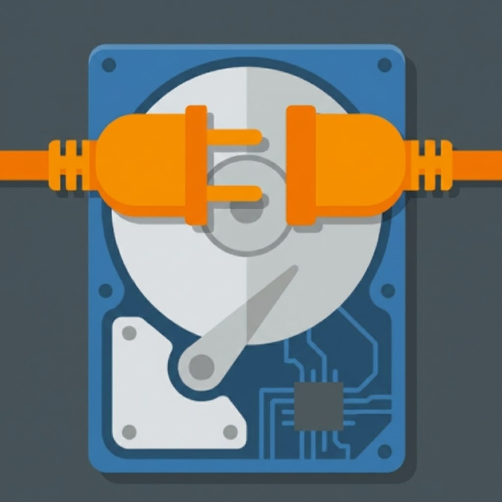

#  Cyswllt

Cyswllt (Welsh for "Connect") - pronounced like "Kuh-swill-it", is a GTK application that allows you to easily mount and unmount your Google Drive on Linux locally.

## Features
-   **Google Authentication**: Securely connect to your Google Drive.
-   **One-Click Mount**: Mount and unmount your drive with a single button.
-   **Clear errors**: If mounting fails (no FUSE, no network, an rclone error), Cyswllt tells you why instead of silently returning to "Ready to Connect".
-   **Safe disconnect**: Files you copy into the drive upload in the background. Disconnect waits until they've finished uploading (see below).
-   **Desktop Integration**: Places a "Google Drive" launcher in `~/Desktop` when mounted. It shows on the desktop only where desktop icons are enabled (for example Ubuntu's desktop; plain GNOME needs an extension), and opens the drive with `xdg-open`.
-   **Open Source**: Released under the GNU GPL v3 license.

## Installation

### Prerequisites
-   Python 3
-   GTK 4 and libadwaita
-   rclone
-   FUSE (`fuse3`, or `fuse` on older systems). The `.deb` package installs these for you.

### Installing the package
```bash
sha512sum -c checksums.sha512
gpg --import pubkey.asc
gpg --verify cyswllt_<version>-1_all.deb.asc cyswllt_<version>-1_all.deb
sudo apt install ./cyswllt_<version>-1_all.deb
```

### Running from Source
```bash
git clone https://github.com/TaliskerMan/Cyswllt.git
cd Cyswllt

# Option A — install with the entry point (recommended):
pip install .
cyswllt

# Option B — run in place without installing:
PYTHONPATH=src python3 -m cyswllt
```
> Note: `python3 src/cyswllt/main.py` does **not** work because the code uses
> absolute imports (`from cyswllt...`). Use one of the commands above.

## Uploads and disconnecting
Cyswllt mounts your Drive with rclone's full file cache, so files you copy into
`~/GoogleDrive` are saved on this computer first and upload in the background.
When you click **Disconnect**, Cyswllt checks for files that haven't finished
uploading. If there are any, it shows **Finishing uploads…** and disconnects
automatically once they're done. You can choose **Stay Connected**, or
**Disconnect Anyway**. If you disconnect early, the remaining files stay in
rclone's cache on this computer (`~/.cache/rclone`, up to 10 GB) and upload the
next time you connect; they aren't on Google Drive until then.

## Security & privacy notes
Cyswllt stores your optional custom Google Client ID/Secret at
`~/.config/cyswllt/google_credentials.json` with `0600` permissions. The Google
Drive **OAuth token itself** is written by rclone to
`~/.config/rclone/rclone.conf` in plaintext (rclone's default, unencrypted). If
you want it encrypted, run `rclone config` and set a config password.

## Contributing
Contributions are welcome! Please update `CyswlltPlan.md` with your changes.
Release artifacts are published to GitHub Releases (not committed to the tree).

## License
GNU GPL v3

## Copyright
Copyright (C) 2026 Chuck Talk, Nordheim Online, LLC <chuck@nordheim.online>
